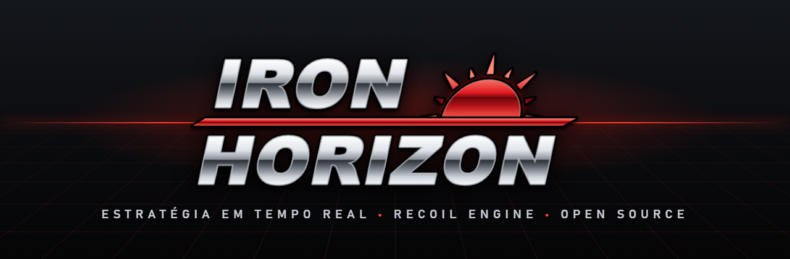

<p align="center">
  
</p>

<p align="center">
  <a href="LICENSE"></a>
  <a href="https://github.com/beyond-all-reason/RecoilEngine"></a>
  
  
</p>

<p align="center">
  <b>Estratégia em tempo real em grande escala, de código aberto.</b><br>
  Construa sua economia, comande exércitos por terra, mar e ar e domine o horizonte.
</p>

---

## Sobre o jogo

**Iron Horizon** é um RTS de código aberto que roda no [Recoil RTS Engine](https://github.com/beyond-all-reason/RecoilEngine).
O projeto é um fork do [Beyond All Reason](https://github.com/beyond-all-reason/Beyond-All-Reason) (BAR) e vai
ganhar identidade própria aos poucos: novas unidades, arte, sons e regras.

### Destaques

- ⚔️ **Batalhas em grande escala**: centenas de unidades por terra, mar e ar.
- 🏭 **Economia de metal e energia**: expanda, construa fábricas e suba de nível tecnológico.
- 🤖 **Modos contra a IA**: inclui os modos Raptors e Scavengers e IAs para treinar.
- 🌍 **Física real de projéteis**: terreno, altura e linha de visão importam.
- 🧩 **Totalmente moddável**: a lógica do jogo é Lua e está toda neste repositório.

## Como rodar (desenvolvimento)

1. Instale o launcher do BAR em https://www.beyondallreason.info/download. Ele baixa o engine Recoil.
2. Abra o launcher e clique em **Open install directory** para achar a pasta de dados
   (no Windows algo como `AppData/Local/Programs/Beyond-All-Reason/data`).
3. Clone este repositório dentro de `data/games/` com o nome `IronHorizon.sdd`:

   ```bash
   git clone https://github.com/RiqueBitt/Iron-Horizon.git IronHorizon.sdd
   ```

4. No lobby, escolha o jogo **Iron Horizon $VERSION** para jogar com a versão local.

## Estrutura do projeto

| Pasta | Conteúdo |
|---|---|
| `units/` | Definições das unidades (status, armas, custos) |
| `weapons/` | Definições de armas |
| `luarules/` | Regras do jogo (gadgets sincronizados) |
| `luaui/` | Interface e widgets |
| `objects3d/`, `unittextures/`, `anims/` | Modelos 3D, texturas e animações |
| `sounds/`, `music/` | Efeitos sonoros e trilha |
| `branding/` | Logotipo, ícone e banner do Iron Horizon |
| `modinfo.lua` | Nome e identidade do jogo |

## Licença

- **Código**: [GPL v2](LICENSE). Pode modificar e redistribuir, desde que o código continue aberto sob GPL.
- **Modelos 3D, texturas e animações**: na maioria são **CC-BY-NC-ND 4.0**, dos artistas do BAR, e estão aqui sem
  modificações. Não podem ser usados comercialmente nem publicados em versões alteradas. Para o Iron Horizon ter
  arte própria, eles vão ser substituídos aos poucos.
- **Imagens, ícones, sons e músicas**: veja [LICENSE.md](LICENSE.md) e os arquivos `license_*.txt`.
- **Logotipo e banner do Iron Horizon** (`branding/`): criados para este projeto.

## Créditos

Todo o crédito pelo código e pela arte originais é da equipe e dos colaboradores do
[Beyond All Reason](https://github.com/beyond-all-reason/Beyond-All-Reason) e do
[Recoil Engine](https://github.com/beyond-all-reason/RecoilEngine). Obrigado!
